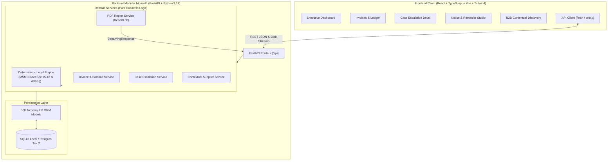

# PayPath MSME — Engineering Architecture & System Design
## SLIET PitchVerse 2026 | Modular Monolith Prototype

---

## 1. Architectural Philosophy

PayPath MSME is designed as a **Modular Monolith** for Tier 1 (PitchVerse 2026), prioritizing functional correctness, technical credibility, deterministic domain calculations, and ease of demonstration over unnecessary microservice overhead.

---

## 2. Separation of Concerns & Clean Boundaries

PayPath MSME enforces strict separation between domain responsibilities:

1. **Presentation & UI State**: Pure React components without embedded SQL queries or unverified legal rules.
2. **API Layer**: FastAPI endpoints with Pydantic v2 validation and structured error handling.
3. **Legal Calculation Engine**: Stateless, deterministic service calculating reference dates, Section 15 caps, and Section 16 compound interest.
4. **Persistence Layer**: SQLAlchemy 2.0 models enforcing ledger invariants (e.g., $Outstanding = Total - Payments$, non-negative constraints).
5. **Document Generation**: ReportLab generating byte streams directly from verified persisted models.
6. **B2B Sponsored Matching Layer**: Completely separated from financial distress or debt collections. Matching operates purely on voluntary industry classification and material keywords.

---

## 3. Three-Tier Evolution Roadmap

### Tier 1 — Working PitchVerse MVP (Completed)
- Persistent SQLite database with transactional consistency.
- Real-time receivables dashboard and KPI calculations.
- Full invoice CRUD with payment recording (full & partial payments).
- Traceable Section 15 & Section 16 MSMED Act calculation engine.
- 8-stage pre-litigation escalation stepper with chronological event audit trail.
- MSEFC evidence completeness matrix (7 core documents).
- Pre-litigation notice studio (Friendly, Urgent, Formal Statutory Notice).
- Downloadable Case-Preparation PDF Report.
- Contextual B2B sponsored supplier discovery with consent-gated enquiries and advertiser perspective.

### Tier 2 — Scalable Cloud Foundation (Target Architecture)
- PostgreSQL database with Alembic migration history.
- S3 / Azure Blob Storage for encrypted documentary evidence uploads.
- JWT-based authentication and role-based access control (RBAC).
- Background workers (Celery / RQ) for scheduled reminders and asynchronous PDF rendering.
- Webhook notifications via verified email / WhatsApp business providers.

### Tier 3 — Advanced Enterprise Capabilities
- OCR pipeline for automatic invoice and delivery challan parsing.
- Automated CARO 2020 / Auditor reporting packages.
- Facilitation Council filing automation via authorized APIs (once officially made available by Ministry of MSME).
- Anonymized industry payment behavior indexing.
