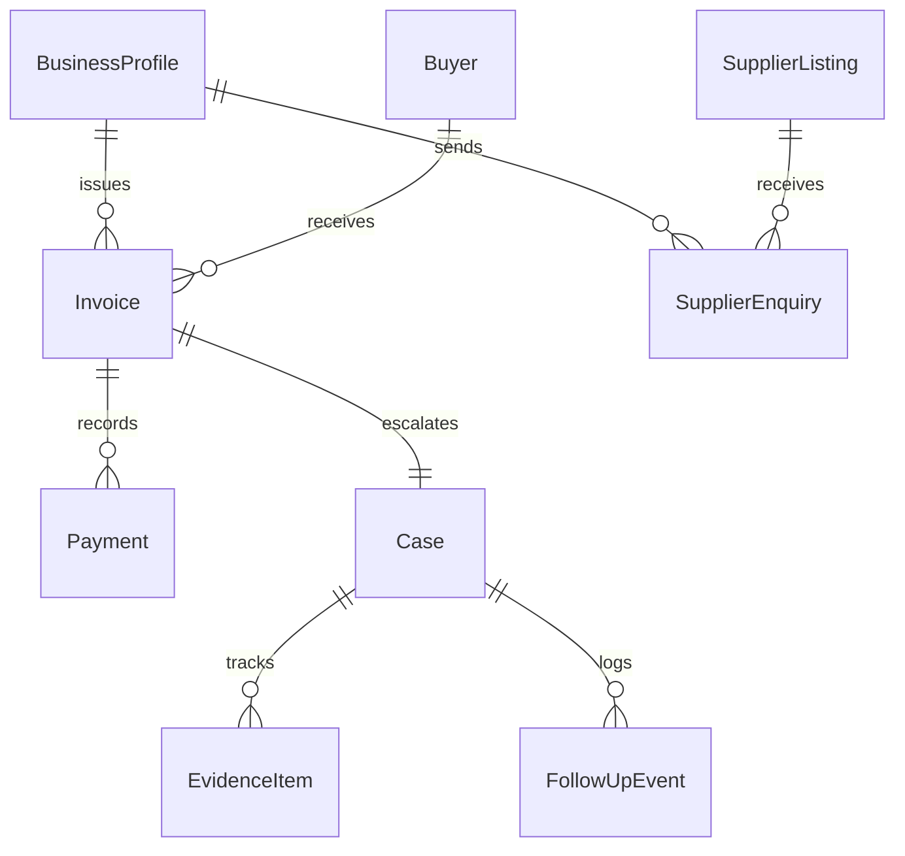

# PayPath MSME — Data Model & Entity Specifications

## 1. Domain Entities & Relationships

The database schema is implemented using SQLAlchemy 2.0 with strict relational integrity:

---

## 2. Table Specifications

### `business_profiles`
- `id` (INTEGER, PK)
- `name` (VARCHAR(255), NOT NULL): Legal company name.
- `enterprise_type` (VARCHAR(50), NOT NULL): `micro`, `small`, or `medium`.
- `udyam_number` (VARCHAR(100), NOT NULL): Official Udyam registration ID.
- `pan` (VARCHAR(50), NULLABLE)
- `gstin` (VARCHAR(50), NULLABLE)
- `state` (VARCHAR(100), NOT NULL)
- `district` (VARCHAR(100), NOT NULL)
- `industry_category` (VARCHAR(100), NOT NULL): Primary sector (e.g., `garment_manufacturing`).
- `purchasing_interests` (VARCHAR(500), NOT NULL): Comma-separated material keywords.
- `contact_email` (VARCHAR(255), NOT NULL)
- `contact_phone` (VARCHAR(50), NOT NULL)
- `created_at` (DATETIME)

### `invoices`
- `id` (INTEGER, PK)
- `invoice_number` (VARCHAR(100), UNIQUE, INDEX, NOT NULL)
- `business_profile_id` (INTEGER, FK -> business_profiles.id, NOT NULL)
- `buyer_id` (INTEGER, FK -> buyers.id, NULLABLE)
- `buyer_name` (VARCHAR(255), NOT NULL)
- `buyer_gstin` (VARCHAR(50), NULLABLE)
- `buyer_contact_email` (VARCHAR(255), NULLABLE)
- `buyer_contact_phone` (VARCHAR(50), NULLABLE)
- `invoice_date` (DATE, NOT NULL)
- `delivery_date` (DATE, NULLABLE): Day of delivery / deemed acceptance.
- `acceptance_date` (DATE, NULLABLE): Day of formal inspection sign-off.
- `has_objection` (BOOLEAN, DEFAULT FALSE)
- `objection_date` (DATE, NULLABLE)
- `objection_resolved_date` (DATE, NULLABLE)
- `has_written_agreement` (BOOLEAN, DEFAULT TRUE)
- `agreed_credit_days` (INTEGER, DEFAULT 30)
- `total_amount` (FLOAT, NOT NULL)
- `paid_amount` (FLOAT, DEFAULT 0.0, NOT NULL)
- `outstanding_balance` (FLOAT, NOT NULL)
- `status` (VARCHAR(50), DEFAULT 'issued'): `draft`, `issued`, `partially_paid`, `paid`, `overdue`, `escalated`.
- `goods_services_description` (TEXT, NULLABLE)
- `notes` (TEXT, NULLABLE)
- `created_at` (DATETIME)
- `updated_at` (DATETIME)

### `payments`
- `id` (INTEGER, PK)
- `invoice_id` (INTEGER, FK -> invoices.id, NOT NULL)
- `payment_date` (DATE, NOT NULL)
- `amount` (FLOAT, NOT NULL)
- `reference_number` (VARCHAR(100), NULLABLE): Bank UTR, Cheque #, or IMPS ID.
- `payment_mode` (VARCHAR(50), NULLABLE): e.g., `Bank Transfer (NEFT/RTGS)`.
- `notes` (TEXT, NULLABLE)
- `created_at` (DATETIME)

### `cases`
- `id` (INTEGER, PK)
- `invoice_id` (INTEGER, FK -> invoices.id, UNIQUE, NOT NULL)
- `reference_code` (VARCHAR(50), UNIQUE, INDEX, NOT NULL): e.g., `CASE-INV-2026-0891`.
- `current_stage` (INTEGER, DEFAULT 1, NOT NULL): Range 1 to 8.
- `stage_label` (VARCHAR(100), NOT NULL)
- `priority` (VARCHAR(50), DEFAULT 'medium', NOT NULL): `low`, `medium`, `high`, `critical`.
- `promised_payment_date` (DATE, NULLABLE)
- `promised_payment_amount` (FLOAT, NULLABLE)
- `notes` (TEXT, NULLABLE)
- `created_at` (DATETIME)
- `updated_at` (DATETIME)

### `evidence_items`
- `id` (INTEGER, PK)
- `case_id` (INTEGER, FK -> cases.id, NOT NULL)
- `category` (VARCHAR(50), NOT NULL): `invoice`, `purchase_order`, `delivery_proof`, `acceptance_record`, `buyer_comm`, `payment_receipt`, `udyam_certificate`, `other`.
- `title` (VARCHAR(255), NOT NULL)
- `status` (VARCHAR(50), DEFAULT 'missing', NOT NULL): `provided`, `missing`, `not_applicable`, `needs_review`.
- `file_name` (VARCHAR(255), NULLABLE)
- `file_size_bytes` (INTEGER, NULLABLE)
- `uploaded_at` (DATETIME, NULLABLE)
- `notes` (TEXT, NULLABLE)

### `follow_up_events`
- `id` (INTEGER, PK)
- `case_id` (INTEGER, FK -> cases.id, NOT NULL)
- `event_type` (VARCHAR(100), NOT NULL): `friendly_reminder`, `firm_follow_up`, `phone_call`, `formal_notice_drafted`, `formal_notice_served`, `payment_promised`, `evidence_reviewed`, `report_generated`, `samadhaan_application_prepared`, `custom`.
- `performed_at` (DATETIME, NOT NULL)
- `summary` (VARCHAR(255), NOT NULL)
- `detail` (TEXT, NULLABLE)
- `next_action_date` (DATE, NULLABLE)
- `recorded_by` (VARCHAR(100), NOT NULL)

### `supplier_listings`
- `id` (INTEGER, PK)
- `company_name` (VARCHAR(255), NOT NULL)
- `industry_category` (VARCHAR(100), NOT NULL)
- `product_tags` (VARCHAR(500), NOT NULL)
- `contact_person` (VARCHAR(255), NOT NULL)
- `contact_email` (VARCHAR(255), NOT NULL)
- `contact_phone` (VARCHAR(50), NOT NULL)
- `city` (VARCHAR(100), NOT NULL)
- `state` (VARCHAR(100), NOT NULL)
- `is_sponsored` (BOOLEAN, DEFAULT TRUE, NOT NULL)
- `sponsorship_tier` (VARCHAR(50), DEFAULT 'featured', NOT NULL)
- `verified` (BOOLEAN, DEFAULT TRUE, NOT NULL)
- `description` (TEXT, NOT NULL)
- `min_order_quantity` (VARCHAR(100), NULLABLE)
- `created_at` (DATETIME)

### `supplier_enquiries`
- `id` (INTEGER, PK)
- `supplier_id` (INTEGER, FK -> supplier_listings.id, NOT NULL)
- `business_profile_id` (INTEGER, FK -> business_profiles.id, NULLABLE)
- `requester_company_name` (VARCHAR(255), NOT NULL)
- `requester_name` (VARCHAR(255), NOT NULL)
- `requester_email` (VARCHAR(255), NOT NULL)
- `requester_phone` (VARCHAR(50), NOT NULL)
- `product_interest` (VARCHAR(255), NOT NULL)
- `message` (TEXT, NOT NULL)
- `consent_given` (BOOLEAN, DEFAULT TRUE, NOT NULL)
- `consent_timestamp` (DATETIME, NOT NULL)
- `created_at` (DATETIME)

---

## 3. Strict Domain Invariants

1. **Balance Invariant**: For every invoice, $\text{Outstanding Balance} = \max(0.0, \text{Total Amount} - \text{Paid Amount})$.
2. **Non-Overpayment Invariant**: Payment amount must be $> 0$ and $\le \text{Outstanding Balance}$.
3. **Settled State Invariant**: When $\text{Outstanding Balance} = 0$, status is automatically set to `paid` and excluded from overdue arrears.
4. **Data Isolation Invariant**: The `supplier_listings` and `supplier_enquiries` domain has zero foreign keys or access paths to `invoices` or `cases`.
